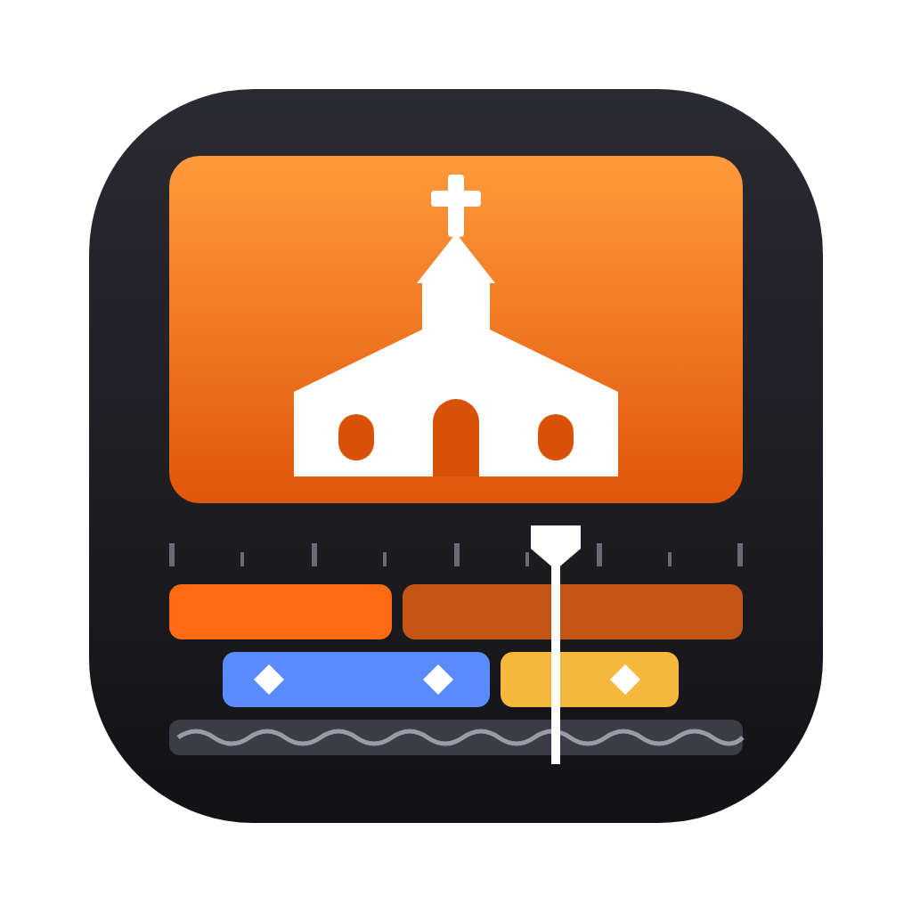
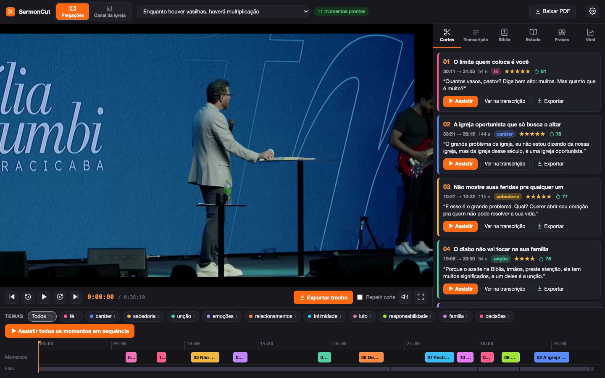
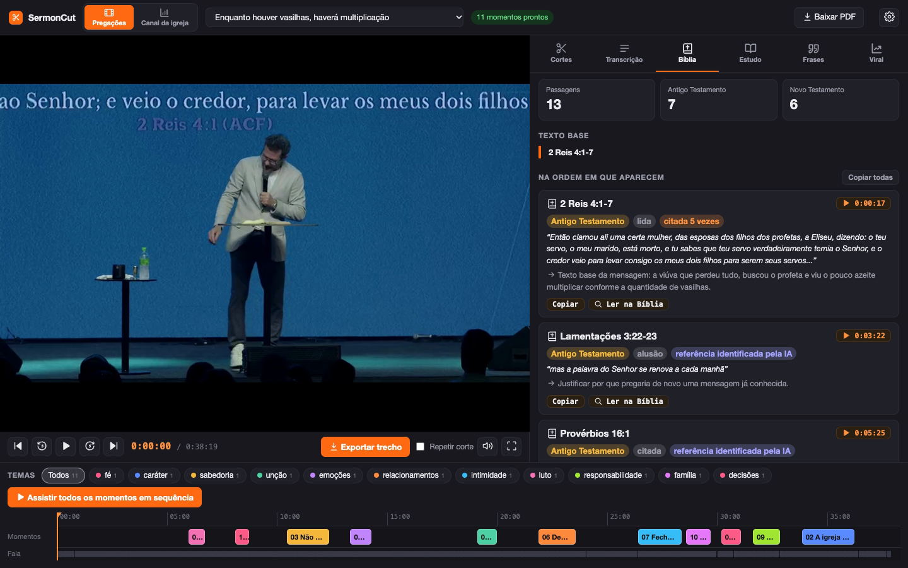
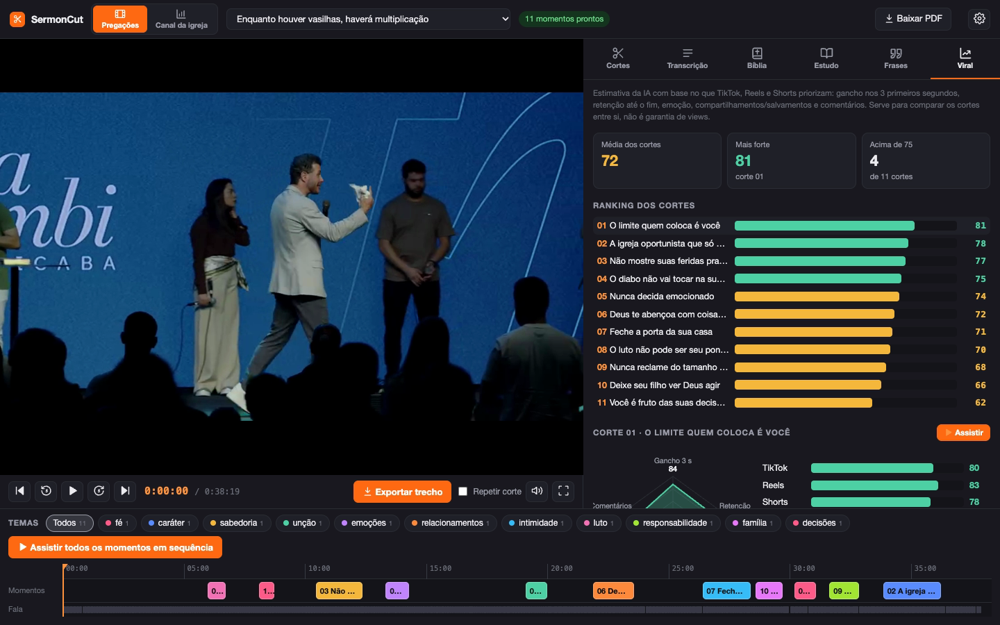
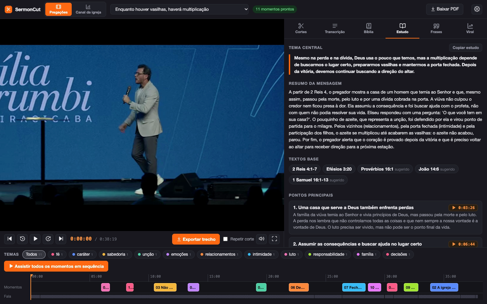
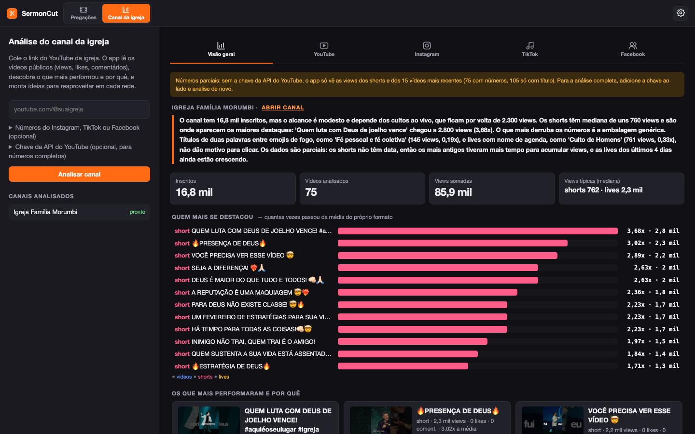
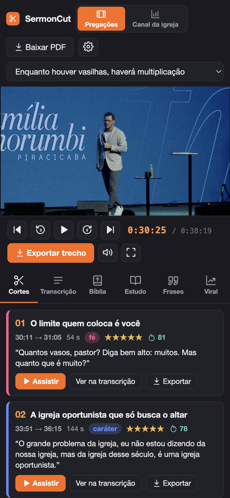

  

<h1 align="center">SermonCut</h1>

  <b>Cortes, estudos e conteúdo a partir da pregação.</b> 
  Para quem edita os vídeos da igreja local.

## Downloads · versão 1.2

| | |
|---|---|
| 🍎 **Mac** (chip Apple M1 ou mais novo) | [**Baixar SermonCut.zip**](https://github.com/ogabrielheid/sermoncut/releases/latest/download/SermonCut.zip) |
| 🪟 **Windows** 10 ou 11 (64 bits) | [**Baixar SermonCut-Windows.zip**](https://github.com/ogabrielheid/sermoncut/releases/latest/download/SermonCut-Windows.zip) |
| 📱 **Celular** (Android e iPhone) | [Como abrir no celular](#no-celular-android-e-iphone): usa o SermonCut do seu computador pelo Wi‑Fi |

---

Você solta o vídeo do culto e o SermonCut transcreve a pregação, encontra os melhores momentos para
cortes (com o minuto exato), gera um estudo com devocional, lista as passagens bíblicas citadas,
sugere frases de efeito e estima quais cortes têm mais chance de viralizar. Tudo numa tela de edição,
com o vídeo, a transcrição clicável e a linha do tempo.

## O que ele faz

| | |
|---|---|
| **Cortes** | 8 a 12 momentos de até 2min59s, com gancho, tema e o porquê de cada um. Clique e assista. |
| **Transcrição** | A pregação inteira com o tempo de cada frase. Clique numa frase e o vídeo vai para ela. |
| **Bíblia** | Todas as passagens lidas ou citadas, com o minuto e para que o pregador usou. |
| **Estudo** | Resumo, pontos principais, lições para aplicar, perguntas para célula e devocional de 5 dias. |
| **Frases** | 15 a 25 frases de efeito para legendas, thumbnails e carrosséis. |
| **Viral** | Uma nota para cada corte com base no que TikTok, Reels e Shorts priorizam. |
| **Exportar** | Baixa o trecho já cortado (720p, 1080p ou 4K; 24, 30 ou 60 fps) para editar no Premiere. |
| **Canal da igreja** | Lê o canal do YouTube, mostra o que mais performou e por quê, e dá ideias para cada rede. |

O vídeo pode vir do computador, de um link do **Google Drive** (vídeo ou pasta) ou do **YouTube**.

  
  

  
  

## Como instalar

### No Mac

**Precisa de:** Mac com chip Apple (M1 ou mais novo), Google Chrome e uns 3 GB livres.

1. [Baixe o **SermonCut.zip**](https://github.com/ogabrielheid/sermoncut/releases/latest/download/SermonCut.zip) e dê dois cliques para abrir.
2. Clique com o botão direito em **Instalar SermonCut.command** e escolha **Abrir**.
   (Na primeira vez o Mac pede essa confirmação porque o app não vem da App Store.)
3. Siga a janela que abrir. Leva uns 5 minutos e instala tudo sozinho.
4. O ícone **SermonCut** aparece na Mesa. Abra e escolha a **IA das análises**.
5. Pronto: arraste o vídeo de um culto em cima do ícone, ou traga pelo Drive ou YouTube.

### No Windows

**Precisa de:** Windows 10 ou 11 (64 bits) e uns 3 GB livres. O app abre no Microsoft Edge, que já vem no Windows.

1. [Baixe o **SermonCut-Windows.zip**](https://github.com/ogabrielheid/sermoncut/releases/latest/download/SermonCut-Windows.zip).
2. Clique com o botão direito no arquivo › **Extrair tudo**.
3. Na pasta extraída, dê dois cliques em **Instalar SermonCut.bat**.
   Se aparecer "O Windows protegeu o computador", clique em **Mais informações › Executar assim mesmo**.
4. Siga a janela que abrir. Leva uns 5 minutos e instala tudo sozinho.
5. O atalho **SermonCut** aparece na Área de Trabalho e no menu Iniciar. Abra e escolha a **IA das análises**.
6. Pronto: arraste o vídeo de um culto em cima do atalho, ou traga pelo Drive ou YouTube.

> A versão para Windows é nova. Se algo não funcionar, fale com o criador (contato no fim da página).

### No celular (Android e iPhone)

O celular usa o SermonCut instalado no seu computador, pelo Wi‑Fi. O computador faz o trabalho pesado
(transcrever e analisar), então ele precisa estar ligado, com o app aberto, na mesma rede do celular.

1. No computador, abra o SermonCut › engrenagem ⚙️ › **Abrir no celular** e ligue a opção.
   Aparecem um **endereço** (ex.: `http://192.168.0.10:47615`) e um **código de acesso**.
2. No celular, abra o **Safari** (iPhone) ou o **Chrome** (Android), digite o endereço e depois o código.
3. Para ficar com ícone de app:
   **iPhone:** Compartilhar › **Adicionar à Tela de Início** · **Android:** ⋮ › **Adicionar à tela inicial**.

No celular dá para assistir aos cortes, ler a transcrição, o estudo, a Bíblia e as frases, copiar textos,
trazer cultos pelo Drive ou YouTube e exportar cortes (o arquivo é baixado no celular).
 

## Qual IA usar

A transcrição, o player e a exportação de cortes são grátis e funcionam no próprio Mac.
A IA faz os cortes, o estudo, as frases e o viral. Você escolhe na primeira vez que abrir o app:

- **Gemini (Google AI Studio):** grátis, com limite diário. Basta criar uma chave em
  [aistudio.google.com/apikey](https://aistudio.google.com/apikey).
- **Conta grátis do ChatGPT, Gemini, Claude ou DeepSeek:** o app copia o pedido, você cola no chat e traz a resposta.
- **Claude Pro ou Max:** usa a sua assinatura, totalmente automático.
- **Chave de API** da Anthropic, OpenAI ou DeepSeek: automático, pago por uso.

Dá para trocar depois na engrenagem ⚙️ › IA das análises.

## Atualizações

O SermonCut avisa quando sai uma versão nova e atualiza com um clique, sem reinstalar.
Seus vídeos, transcrições, cortes e configurações continuam como estão.

## Privacidade

Tudo roda no seu computador. Os vídeos não são enviados para lugar nenhum. Para as análises, só o texto da
transcrição vai para a IA que você escolher. Suas chaves ficam guardadas só no seu computador. O acesso pelo celular fica desligado até você ligar,
e é protegido por um código.

## Quer os cortes prontos para postar?

O SermonCut encontra os melhores momentos e entrega o trecho cortado. A **finalização** (legendas
dinâmicas, música, efeitos e enquadramento vertical no pregador) é feita por quem criou o app:
dentro do SermonCut, clique em **Quero finalizado** em qualquer corte e o pedido já vai pronto.
Veja exemplos no Instagram [@ogabrielheid](https://instagram.com/ogabrielheid).

## Quem criou

**Gabriel Krause Heidemann** · [@ogabrielheid](https://instagram.com/ogabrielheid)

Como editor, percebi que não existia nada feito especificamente para quem faz cortes de pregação da
sua igreja local. O SermonCut nasceu para ajudar quem trabalha com isso, ou quem quer servir a própria
igreja criando conteúdo. Hoje faço parte da Igreja Família Morumbi, liderada pelos apóstolos Cesar e
Carla Graciane.

---

O código do app está na pasta <code>app/</code>. Todas as versões ficam em <a href="https://github.com/ogabrielheid/sermoncut/releases">Releases</a>.
